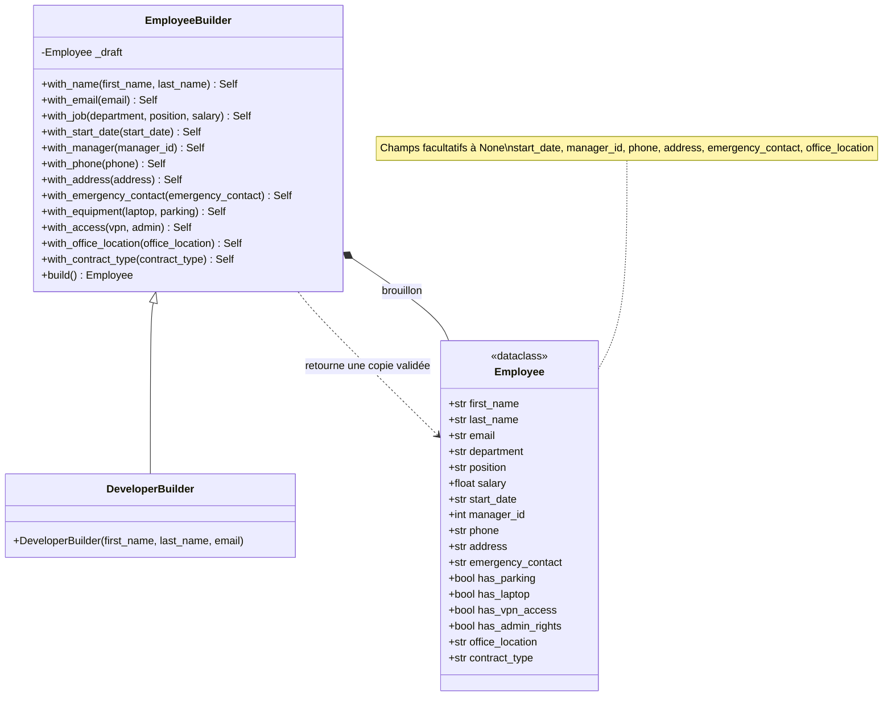

# Builder Pattern — HR Employee Onboarding System

`EmployeeBuilder` configure un brouillon, puis `build()` valide ses données et retourne une copie indépendante. `DeveloperBuilder` reprend les mêmes méthodes avec une configuration initiale pour le poste de développeur.
