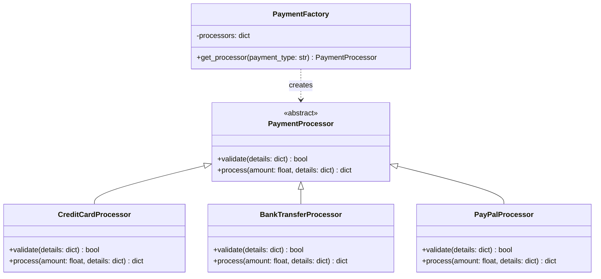

# Factory Pattern — Payment System

## UML Class Diagram

## Design Explanation

The PaymentProcessor abstract class defines a common
interface for validating and processing payments.

Each concrete processor implements its own validation
rules and fee calculation:

- CreditCardProcessor: 2.9% fee
- BankTransferProcessor: 1.50 EUR flat fee
- PayPalProcessor: 3.4% + 0.30 EUR fee

PaymentFactory uses a dictionary to map payment types
to processor classes, avoiding long if/elif chains.

## Benefits

- Follows the Open/Closed Principle
- Separates payment creation from payment processing
- Makes it easier to add new payment methods
- Allows each processor to be tested independently
