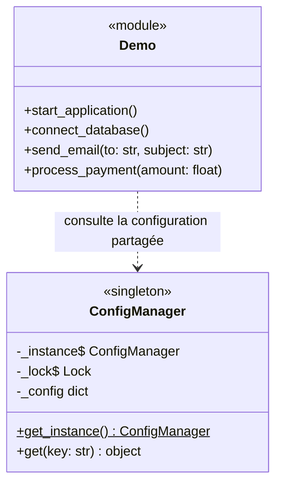

# Singleton Pattern — Basic Configuration Manager

Le premier accès charge `config.json`. Le verrou empêche deux appels simultanés de créer chacun leur instance. Les quatre fonctions de la démonstration consultent cette même instance.
