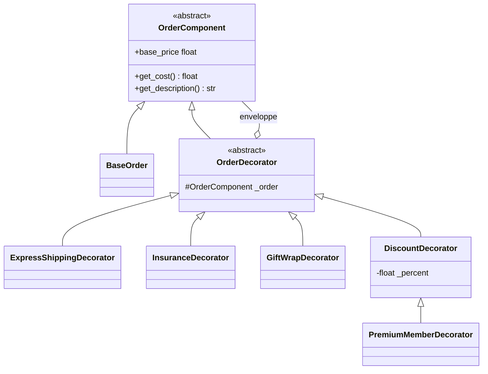

# Decorator Pattern — Order Pricing System

Chaque décorateur enveloppe une commande et ajoute une ligne au détail du prix. Le prix de base reste accessible à travers la chaîne pour calculer l’assurance.
