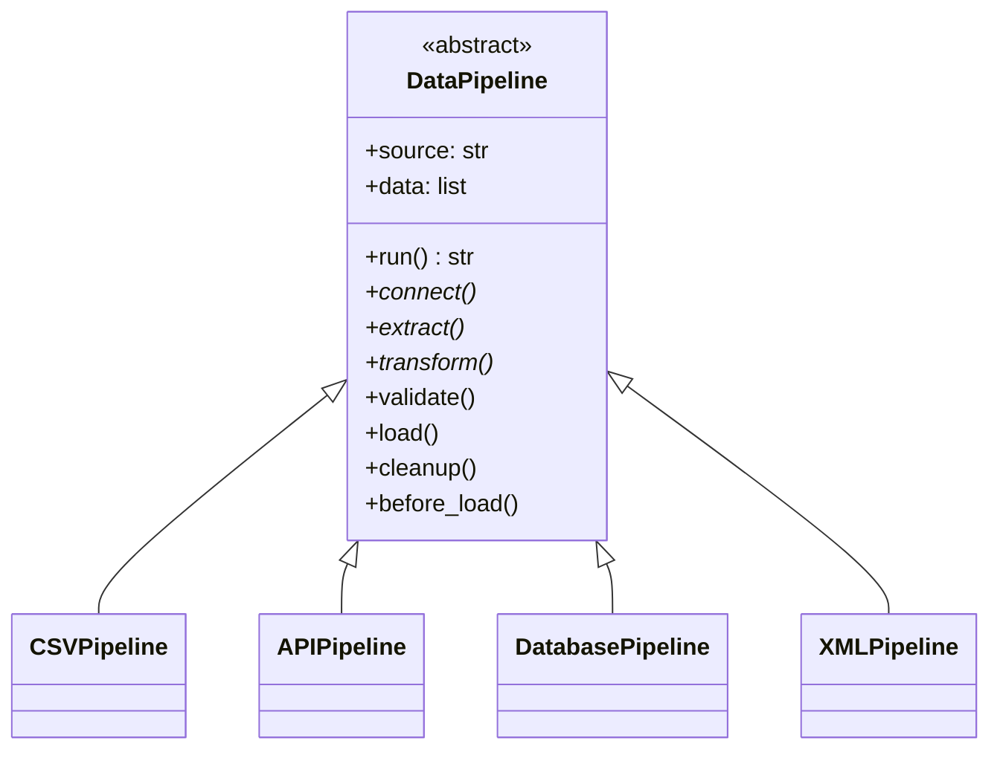

# Template Method Pattern — Data ETL Pipeline

## UML Class Diagram

## Design Explanation

The run() method defines the fixed ETL workflow.
Concrete pipelines implement source-specific steps.
Validation and cleanup are shared across pipelines.
The before_load() method is an optional hook.
